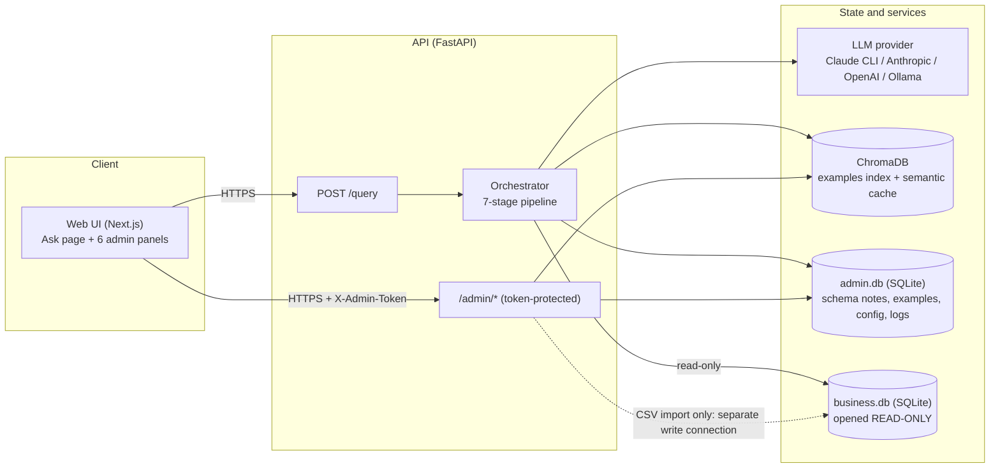
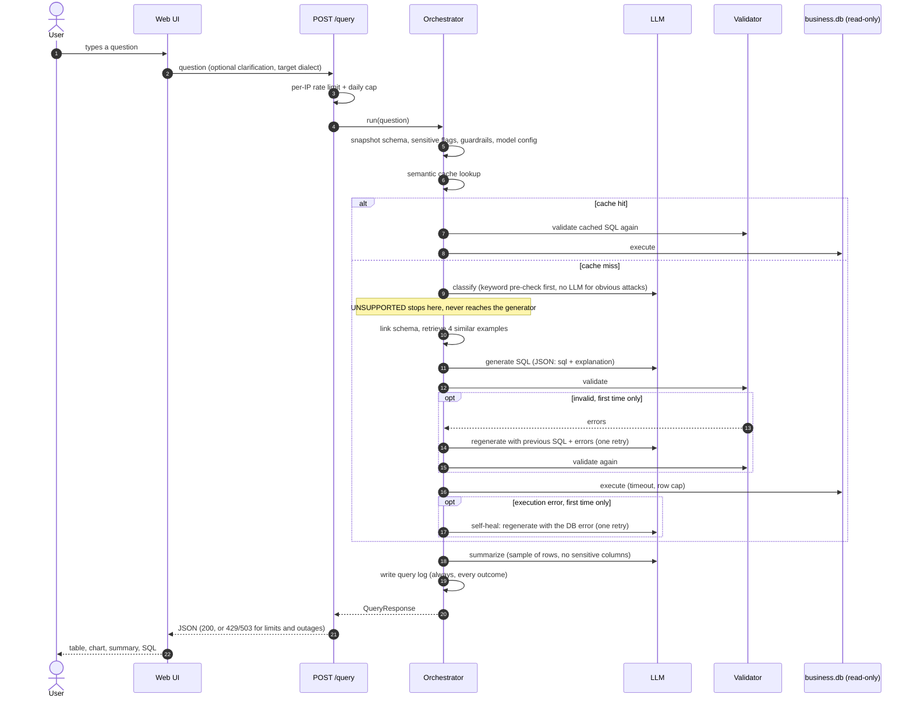
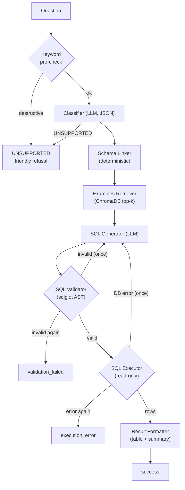
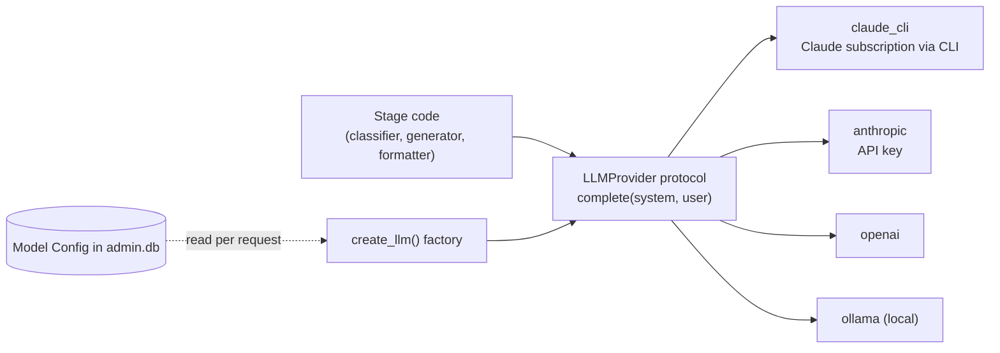
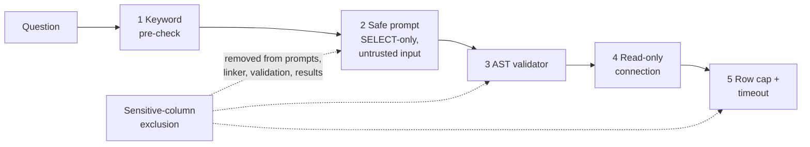
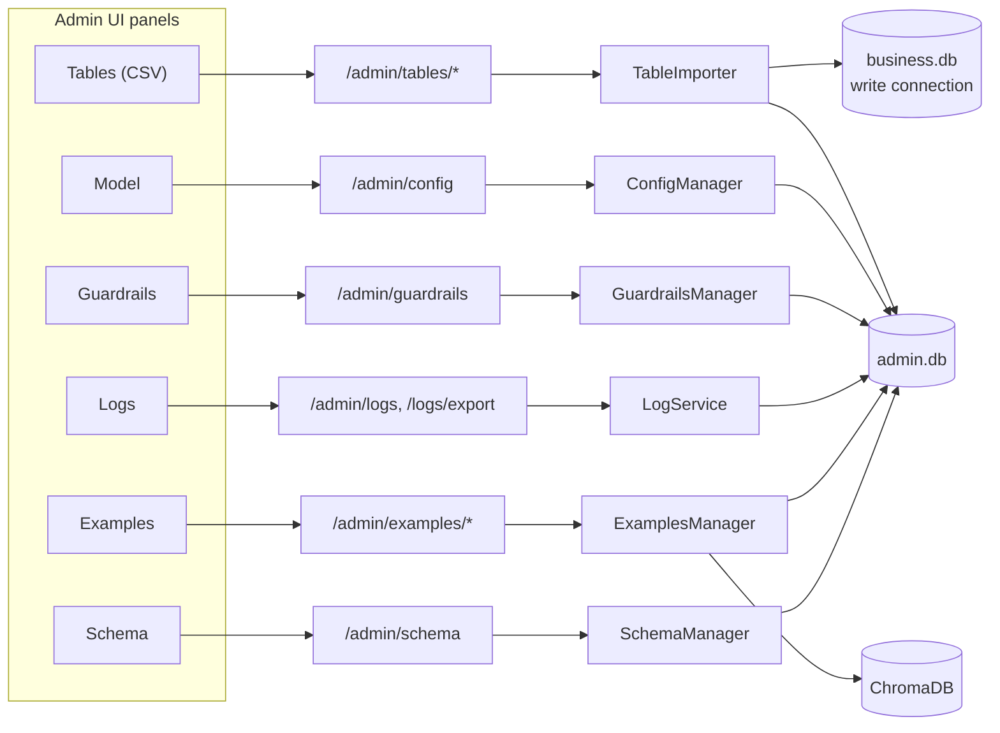
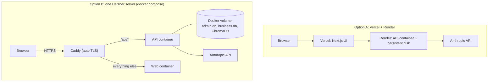

# QueryMind AI: Architecture

QueryMind turns a plain-English question into a validated, read-only SQL query, runs it, and returns a table plus a short summary. This document explains how it is built and why. For setup and usage see the [README](README.md); for hosting see [DEPLOY.md](DEPLOY.md) and [HETZNER.md](HETZNER.md).

**Contents:** [System overview](#1-system-overview) · [One request, end to end](#2-one-request-end-to-end) · [The pipeline stages](#3-the-pipeline-stages) · [State and storage](#4-state-and-storage) · [The LLM layer](#5-the-llm-layer) · [Safety architecture](#6-safety-architecture) · [The admin plane](#7-the-admin-plane) · [Frontend](#8-frontend) · [Deployment topologies](#9-deployment-topologies) · [Cross-cutting concerns](#10-cross-cutting-concerns) · [Design decisions](#11-design-decisions-and-trade-offs) · [Extending the system](#12-extending-the-system)

---

## 1. System overview

Three principles shape everything below:

1. **Every stage is independent.** Each pipeline stage is a plain class with injected dependencies and typed Pydantic input and output models, so it can be called and unit-tested alone with a fake LLM.
2. **Safety is layered, never singular.** A destructive query must get past a keyword check, a prompt, an AST validator and a read-only database connection. Sensitive columns are removed from everything the model sees.
3. **Admin changes apply on the next request.** Nothing is cached in the process that an admin edit could leave stale; each request takes a fresh snapshot of schema, guardrails and model settings.

## 2. One request, end to end

Outcomes are typed in `QueryResponse.status`: `success`, `unsupported`, `validation_failed`, `execution_error`, `needs_clarification` and `error`. Handled outcomes return HTTP 200 with the status; only infrastructure problems return an error code (429 rate limited, 503 model unavailable or internal error).

## 3. The pipeline stages

| Stage | Code | Input → output | Behaviour worth knowing |
|---|---|---|---|
| **Classifier** | [`pipeline/classifier.py`](backend/app/pipeline/classifier.py) | question → `query_type`, tables, columns | Regex pre-check refuses obvious destructive intent *before any LLM call*. The LLM then returns structured JSON; malformed output gets one retry, then fails safe to `UNSUPPORTED`. A provider outage propagates (503), it is not misreported as "unsupported". Mentioned names are filtered to existing, non-sensitive ones. |
| **Schema Linker** | [`pipeline/schema_linker.py`](backend/app/pipeline/schema_linker.py) | question → resolved tables and columns, ambiguities | Deterministic (no LLM): matches names and the `(also: synonym, …)` lists in column descriptions. Records an ambiguity when one term maps to several columns (e.g. "revenue"). Only ever sees the non-sensitive schema. |
| **Examples Retriever** | [`pipeline/examples_retriever.py`](backend/app/pipeline/examples_retriever.py) | question → top 3–5 (question, SQL) pairs (default 4) | Embeds the question and queries ChromaDB. An optional query-type filter ranks same-type examples first and fills the rest from the unfiltered ranking. |
| **SQL Generator** | [`pipeline/sql_generator.py`](backend/app/pipeline/sql_generator.py) | linked context + examples → `sql`, `explanation` | Builds the prompt: SELECT-only rules, dialect hint, explicit date ranges computed from the reference date, domain notes, non-sensitive schema with descriptions, relevant columns, ambiguity notes or the user's clarification, similar examples, and (on retry) the previous SQL and error. The question is marked as untrusted data. |
| **SQL Validator** | [`pipeline/sql_validator.py`](backend/app/pipeline/sql_validator.py) | SQL → `valid`, `sanitized_sql`, `errors` | See [section 6](#6-safety-architecture). The returned SQL is *re-rendered from the validated AST*. |
| **SQL Executor** | [`pipeline/sql_executor.py`](backend/app/pipeline/sql_executor.py) | SQL → columns, rows, `latency_ms`, safe `error` | Read-only engine, query timeout, hard 10,000-row backstop. Raw database errors are logged and kept in an internal field, never returned to clients. |
| **Result Formatter** | [`pipeline/result_formatter.py`](backend/app/pipeline/result_formatter.py) | rows → `table`, `nl_summary` | Drops sensitive columns, sends the LLM at most 10 rows and 2,500 characters, returns "No rows matched…" for empty results without calling the LLM, and falls back to a plain summary if the LLM fails. |
| **Orchestrator** | [`pipeline/orchestrator.py`](backend/app/pipeline/orchestrator.py) | request → `QueryResponse` | Wires the stages, owns the two retries, records per-stage timings, consults the semantic cache, and **always** writes a log row. |

All stage input and output models live in [`backend/app/schemas/`](backend/app/schemas/), one file per stage.

## 4. State and storage

| Store | Technology | Holds | Written by | Read by |
|---|---|---|---|---|
| **business.db** | SQLite file | The data being queried (demo: 7 e-commerce tables) | Seed script, and the CSV importer through its **own** write connection | Queries, through a `mode=ro` connection |
| **admin.db** | SQLite file (SQLAlchemy) | Table and column descriptions and sensitive flags, example library, guardrails, model config, query logs, imported-table registry | Admin API, orchestrator (logs) | Every request (fresh read each time) |
| **ChromaDB** | Persistent vector store | Collection `examples` (embedded questions, SQL in metadata) and `query_cache` (semantic cache) | Examples manager, orchestrator | Retriever, cache |

Key relationships:

- `admin.db` is the **source of truth** for examples; the vector index is derived from it. Every create, edit and delete re-embeds or removes the vector, and `POST /admin/examples/reindex` rebuilds the index from scratch.
- The **schema is introspected live** from `business.db` on each request and merged with admin-written descriptions and flags. A newly created table appears immediately.
- **Dialect handling** sits behind one small abstraction ([`db/dialects.py`](backend/app/db/dialects.py)): the sqlglot name plus a prompt hint per dialect. Only SQLite is exercised end to end.

## 5. The LLM layer

- Stages depend only on the `LLMProvider` protocol ([`llm/base.py`](backend/app/llm/base.py)); provider, model, temperature and token budget come from the **Model Config** and are never hard-coded in stage logic.
- The orchestrator builds the provider **per request**, so a Model Config change takes effect on the next question. It wraps it in a lazy proxy, so requests that never need the model (a keyword-blocked "delete everything") work even with no API key configured.
- Structured output goes through `complete_structured()`: strip code fences, parse JSON, validate with Pydantic; failures raise a typed `LLMOutputError` that stages handle explicitly.
- The **`claude_cli` provider** ([`llm/claude_cli_provider.py`](backend/app/llm/claude_cli_provider.py)) uses your Claude subscription through the official CLI in headless mode: tools disabled, no user settings or MCP servers loaded, empty working directory, user text on stdin, and API-key variables removed from the child environment so it can never bill the API. It cannot set temperature or token limits.

## 6. Safety architecture

| Layer | Where | What it guarantees |
|---|---|---|
| **1. Keyword pre-check** | `classifier.py` | Obvious destructive requests ("delete all orders", "drop table", "update … set") are refused before any LLM call, so they are refused even with no model configured. |
| **2. Safe prompting** | `sql_generator.py` | The generator is told to output one read-only SELECT and to treat the question as data, not instructions. |
| **3. AST validator** | `sql_validator.py` | Decisions use the sqlglot **syntax tree**, not substring matching. Blocks DROP, DELETE, UPDATE, INSERT, TRUNCATE, ALTER, CREATE (unless the admin toggles one on), plus PRAGMA, ATTACH, REPLACE, transactions and `load_extension()`; rejects stacked queries; verifies every table and column exists; enforces table-prefix and schema scope; appends or clamps `LIMIT`. A `DELETE` hidden in a CTE is caught, and a column named `updated_at` is not a false positive. The SQL that runs is **re-rendered from the validated tree**, so comments and parser quirks cannot smuggle anything through. |
| **4. Read-only connection** | `db/business.py` | SQLite opens with `mode=ro`, so a write fails at the database even if every other layer were bypassed (tested directly). |
| **5. Limits** | `sql_executor.py`, `rate_limit.py` | Query timeout, hard row cap, per-visitor hourly limit and a daily cap across all visitors. |

**Sensitive columns** (flagged in the Schema panel, or suggested automatically on CSV import) are enforced at every point the data could leak: the schema shown to any LLM, the linker output, validation (including through CTEs, subqueries and `SELECT *`, which is re-expanded against the non-sensitive schema), and the result table. A test captures every prompt sent to the model and asserts no sensitive column name appears.

**Public-deployment protections** (off by default for local use): an **admin token** (`X-Admin-Token`, compared in constant time) on everything under `/admin`; a **sliding-window rate limit** per client IP with a global **daily cap**, where the client IP is taken as the Nth entry from the *right* of `X-Forwarded-For` because earlier entries are client-controlled; and configurable **CORS**.

## 7. The admin plane

Each router is thin and delegates to a service in [`backend/app/services/`](backend/app/services/). Because services read `admin.db` on every call, edits take effect on the next request without a restart.

**CSV table import** ([`services/table_importer.py`](backend/app/services/table_importer.py)) is the one feature that writes to the business database, so it is isolated:

1. `POST /admin/tables/preview` parses the file in memory (delimiter and encoding detection, type inference over all rows, safe identifier names, suggested descriptions, suggested sensitive columns) and writes nothing.
2. `POST /admin/tables/import` re-parses the same file with the admin's final choices, validates every identifier against both SQLite and sqlglot, coerces values strictly, then creates the table and inserts rows in **one transaction** using bound parameters (cell contents are never interpolated into SQL).
3. Only tables created this way are tracked in `imported_tables`, so only they can be replaced or deleted from the UI; original tables are protected. `ALLOW_TABLE_IMPORT=false` disables the feature.

## 8. Frontend

Next.js (App Router) with TypeScript and Tailwind, in [`frontend/src/`](frontend/src/).

| Area | Files | Notes |
|---|---|---|
| Ask page | `app/page.tsx`, `components/DataTable.tsx`, `ResultChart.tsx`, `VoiceButton.tsx` | Sortable table (TanStack), bar or line chart for two-column results, collapsible SQL panel, Explain mode, "Also show SQL as…" dialect rewrite, "Did you mean…" buttons for ambiguities, voice input via the Web Speech API. |
| Admin panels | `app/admin/{schema,tables,examples,logs,guardrails,model}/page.tsx` | Each calls one admin router; toasts report success or the server's validation messages. |
| Admin sign-in | `app/admin/layout.tsx`, `lib/adminToken.ts` | If the server has `ADMIN_TOKEN`, the layout asks for it once per browser tab (kept in `sessionStorage`, never in the URL) and the API client sends it as `X-Admin-Token`. |
| API client | `lib/api.ts`, `lib/types.ts` | Typed fetch wrappers; one place builds headers and turns FastAPI's error shapes into readable messages. `NEXT_PUBLIC_API_URL` is baked in at build time. |

## 9. Deployment topologies

The API needs a **persistent disk** (three stores above) and about **0.9 GB of RAM** (mostly the embedding model), which is why it cannot run on a serverless host. The web UI has no such needs. Public deployments need an Anthropic API key because the subscription login is personal. Step-by-step guides: [DEPLOY.md](DEPLOY.md) (Vercel + Render), [HETZNER.md](HETZNER.md) (single server). Railway works too using the same `backend/Dockerfile`.

## 10. Cross-cutting concerns

- **Dependency injection, no hidden globals.** [`deps.py`](backend/app/deps.py) builds a `Container` once (`build_container`), and [`main.py`](backend/app/main.py) exposes `create_app(settings, llm_factory)`, so tests substitute a fake LLM, offline embeddings and temporary databases.
- **Configuration.** Bootstrap values come from environment variables ([`config.py`](backend/app/config.py), `.env.example`); everything an admin can change at runtime lives in `admin.db`.
- **Observability.** Every request, whatever its outcome, writes a row to the query log with the SQL, status, error, latency, row count and **per-stage timings** (`cache_lookup`, `classify`, `link`, `retrieve`, `generate`, `validate`, `execute`, `heal`, `format`). The Logs panel filters and exports it.
- **Caching.** The semantic cache reuses SQL for near-identical questions but still re-validates and re-executes on every hit, so a stale entry can never bypass a guardrail. Its key space is partitioned by a hash of model config, guardrails, schema and sensitive flags, so admin changes invalidate it.
- **Error handling.** Consistent `{error, detail}` bodies; validation errors are stripped of internals; raw database errors never reach clients.
- **Testing.** 220 offline tests: each stage with a mocked LLM, the orchestrator with a scripted LLM, every admin route including persistence across app restarts, the importer, rate limits, CORS and the admin token. [`backend/eval/`](backend/eval/) adds a reproducible evaluation harness (25 questions with ground-truth SQL, plus a 28-attack guardrail suite); latest results are in the [README](README.md#evaluation).

## 11. Design decisions and trade-offs

| Decision | Why | Trade-off |
|---|---|---|
| Deterministic schema linker (no LLM) | Fast, testable, cannot leak data to a model | Matches names and synonyms, not meaning; paraphrases rely on retrieved examples |
| Validate on the **AST** and execute the re-rendered SQL | Closes comment and parser-differential tricks; no false positives on column names | Depends on sqlglot's coverage of the dialect |
| Read-only DB connection *in addition to* validation | A validator bug cannot become a data-loss bug | None significant |
| Separate write connection used only by the CSV importer | Keeps the query path provably read-only | One extra engine to configure |
| `admin.db` as source of truth, vector index derived | Index can always be rebuilt; edits are transactional | Index can drift if written around the manager (hence `reindex`) |
| Per-request snapshot of schema, guardrails and config | Admin edits apply immediately, no restart or cache invalidation | A few small reads per request |
| Single worker, in-memory rate limiter | Simple and correct for one container | Limits reset on restart; do not scale horizontally without a shared store |
| Subscription CLI provider for development | No API key needed | No temperature control, a few seconds of start-up per call, personal login (not for public sites) |
| Shared admin token instead of user accounts | Small, auditable surface | No per-user identity or roles |

## 12. Extending the system

- **Add a database dialect:** add an entry to `DIALECTS` in `db/dialects.py` (sqlglot name and prompt hint); provide a read-only connection in `db/business.py` and a timeout hook in the executor.
- **Add an LLM provider:** implement `complete(system, user, *, max_tokens=None)` with `model`, `temperature` and `max_tokens` attributes, register it in `llm/__init__.py`, and add the name to `PROVIDERS` in `services/config_manager.py`.
- **Add or change a pipeline stage:** define its input and output models in `schemas/`, implement a class taking its dependencies in the constructor, and wire it in `pipeline/orchestrator.py` (add a `_timed` block so it appears in the logs).
- **Add a guardrail:** extend `GuardrailConfig` in `schemas/validator.py` and check it in `SQLValidator`; the Guardrails panel and API pick up new toggles through the typed model.
- **Teach it a new subject area:** import data (Tables panel), describe columns and add `(also: …)` synonyms (Schema panel), add 5 to 10 example questions (Examples panel), and edit `backend/data/domain_notes.md` for business conventions.

For known limitations and planned work, see [README: Known limitations](README.md#known-limitations-and-future-work).
